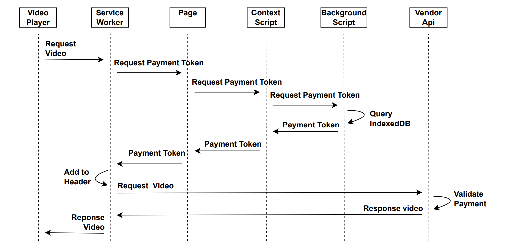

# MiniMoni: Combining HLS with Payword

Existing micropayment systems struggle to achieve widespread adoption for continuous video streaming due to scalability limitations, security vulnerabilities related to token management, and tight coupling with specific video players. MiniMoni addresses these challenges by integrating the widely supported HTTP Live Streaming (HLS) protocol with PayWord, embedding payments directly into segment HTTP requests for atomic payment and delivery. The solution is implemented using player-agnostic integration and a secure browser extension for isolated token management, along with a three-step relay mechanism for secure inter-component communication. As such, MiniMoni provides a scalable and secure approach to continuous streaming monetization without requiring player-specific modifications.

## Estrutura do README.MD

Este README está organizado nas seguintes seções:

1. **[Introdução](#minimoni-combining-hls-with-payword)** - Visão geral do projeto MiniMoni
2. **[Selos Considerados](#selos-considerados)** - Selos de avaliação acadêmica
3. **[Informações Básicas](#informações-básicas)** - Requisitos de hardware e software
4. **[Arquitetura e Sistema de Arquivos](#arquitetura-e-sistema-de-arquivos)** - Visão de componentes e mapeamento de diretórios
5. **[Dependências](#dependências)** - Docker, Docker Compose e MetaMask
6. **[Preocupações com Segurança](#preocupações-com-segurança)** - Avaliação de riscos
7. **[Vídeos de Apoio](#vídeos-de-apoio)** - Instalação e demonstração guiadas
8. **[Instalação](#instalação)** - Guia passo a passo completo
9. **[Teste Mínimo](#teste-mínimo)** - Validação básica do sistema
10. **[Experimentos](#experimentos)** - Três reivindicações principais com procedimentos de validação
11. **[Troubleshooting / Erros Comuns](#troubleshooting--erros-comuns)** - Soluções para problemas comuns
12. **[LICENSE](#license)** - Licença MIT do projeto

## Selos Considerados

Os selos considerados são:

- **Artefatos Disponíveis (SeloD)**
- **Artefatos Funcionais (SeloF)**
- **Artefatos Sustentáveis (SeloS)**
- **Experimentos Reprodutíveis (SeloR)**

## Informações básicas

Este projeto implementa um sistema completo de streaming de vídeo com micropagamentos usando blockchain Ethereum. O ambiente de execução requer:

**Requisitos de Hardware:**

- Memória RAM: Mínimo 4GB, recomendado 8GB
- Armazenamento (mínimo, com base nas medições e tamanhos oficiais):
  - Imagens Docker: ~0.93GB (hardhat ~464MB, vendor-api ~404MB, debug-web-extension ~55.8MB, vite-web-extension ~8.39MB)
  - Dados/volumes em runtime (cache do Hardhat, banco SQLite, builds locais, logs): ≥0.5GB
  - Navegador (instalação): Chrome (Linux) ~61MB; Firefox ~500MB
  - Total mínimo sugerido:
    - Com Chrome: ~1.5GB livres
    - Com Firefox: ~2.0GB livres
- Conexão com internet estável

**Requisitos de Software:**

- Sistema Operacional: Linux, macOS ou Windows
- Docker version 28.2.2 ou superior
- Docker Compose version v2.36.2 ou superior
- Navegador: Google Chrome ou Mozilla Firefox

## Arquitetura e Sistema de Arquivos




Em alto nível, quando o player requisita um segmento HLS, o Service Worker (`debug-web-extension/src/service-worker.ts`) intercepta a requisição e envia `SW_FETCH_INTERCEPT` para a página; a página repassa via `MessageBus` (`debug-web-extension/src/lib/MessageBus.ts`) ao Content Script, que por sua vez consulta o Background (`vite-web-extension/src/pages/background/index.ts`) pedindo o próximo token com `GET_SELECTED_HASHCHAIN` e `GET_NEXT_HASH`. O Background lê/atualiza a hashchain no IndexedDB (`vite-web-extension/src/pages/background/indexedDBClient.ts`) e retorna `nextHash`, `index` e `contractAddress`. A página responde ao Service Worker, que injeta os headers `X-Hash`, `x-hash-index` e `x-smart-contract-address` e reenvida a requisição. Do lado do servidor, a Vendor API valida esses headers no middleware de HLS (`vendor-api/src/routes/hls/index.ts`), checando canal, gasto duplo e cadeia de hashes antes de entregar o segmento.


Partindo do fluxo de dados ilustrado acima, a arquitetura é composta por uma extensão de navegador e uma API de Vendedor (servidor) que validam pagamentos PayWord a cada segmento HLS.

- Video Player → Service Worker: o Service Worker intercepta requisições HLS e inicia o ciclo de obtenção do token.
- Page ↔ Content Script ↔ Background: a página repassa o evento via `MessageBus` para o Content Script, que solicita ao Background o próximo token da hashchain.
- Background ↔ IndexedDB: o Background lê/atualiza a hashchain no IndexedDB e devolve `nextHash`, `index` e `contractAddress`.
- Service Worker → Vendor API: os headers de pagamento são inseridos e enviados; o servidor valida e só então entrega o segmento.

Aarquivos principais:

1. Interceptação HLS no Service Worker: `debug-web-extension/src/service-worker.ts`
2. Ponte de mensagens na página: `debug-web-extension/src/lib/MessageBus.ts`
3. Mediação no Content Script: `vite-web-extension/src/pages/content/index.tsx`
4. Lógica de hashchain no Background: `vite-web-extension/src/pages/background/index.ts`
5. Persistência IndexedDB: `vite-web-extension/src/pages/background/indexedDBClient.ts`
6. Validação e entrega HLS (servidor): `vendor-api/src/routes/hls/index.ts`

Mapa de diretórios de alto nível:

- `vite-web-extension/`: código da extensão (content script, background, manifest, build para Chrome/Firefox).
- `debug-web-extension/`: utilitários de depuração/ponte com a página, incluindo o `Service Worker` e `MessageBus` usados nos testes locais.
- `vendor-api/`: API do Vendedor (Hono + Prisma). Rota HLS e validação de pagamentos; diretório `data/` armazena o conteúdo HLS gerado por `init_video.sh`.
- `hardhat/`: contratos, scripts e rede local Ethereum para desenvolvimento/testes.
- `assets/`: artefatos de documentação (ex.: `data-flow.png`).
- `docker-compose.yml`: orquestração dos serviços para desenvolvimento.

## Dependências

**Dependências principais:**

- Docker: 28.2.2+
- Docker Compose: v2.36.2+

**Recursos de terceiros:**

- MetaMask deve ser instalado manualmente do site oficial: https://metamask.io/download
- Todos os outros recursos são obtidos automaticamente via Docker

## Preocupações com segurança

Não há riscos de segurança para os revisores.

## Vídeos de apoio

Os seguintes vídeos fornecem acesso completo ao código e orientam o processo de configuração e uso do sistema:

- **Vídeo de Instalação**: [YouTube - Instalação](https://youtu.be/TDhcyu8ikEI)
- **Vídeo de Demonstração**: [YouTube - Demonstração](https://youtu.be/bpFZVlYnUa0)

## Instalação

1. **Clone o repositório:**

   ```bash
   git clone https://github.com/otaviootavio/sbseg-sf-minimoni/
   cd sbseg-sf-minimoni
   ```

2. **Instale o Docker e Docker Compose:**

   - Siga as instruções oficiais para o seu sistema operacional
   - Verifique as versões: `docker --version` e `docker compose version`

3. **Instale o MetaMask:**

   - Acesse https://metamask.io/download
   - Instale a extensão no seu navegador
   - Crie uma carteira ou importe uma existente

4. **Inicie o ambiente completo:**

   ```bash
   docker compose up --build
   ```

5. **Construa a extensão do navegador:**

   ```bash
   cd vite-web-extension
   docker build --output type=local,dest=. .
   ```

   > **Nota:** O comando anterior irá compilar a extensão e criar um diretório chamado `dist_chrome` (e/ou `dist_firefox`) dentro da pasta `vite-web-extension`. É este o diretório que você irá selecionar no passo a seguir.

6. **Carregue a extensão no navegador:**
   Siga as instruções para o seu navegador de preferência:

   <details>
   <summary><strong>Google Chrome</strong></summary>

   1. Abra o Chrome e acesse a URL: `chrome://extensions/`
   2. No canto superior direito, ative o **Modo de desenvolvedor**.
   3. Clique no botão **"Carregar sem compactação"**.
   4. Na janela que abrir, navegue até a pasta do projeto e selecione o diretório `vite-web-extension/dist_chrome`.
   5. A extensão MiniMoni deverá aparecer na sua lista de extensões.

   </details>

   <details>
   <summary><strong>Mozilla Firefox</strong></summary>

   1. Abra o Firefox e acesse a URL: `about:debugging#/runtime/this-firefox`
   2. Clique no botão **"Carregar Pacote Temporário..."**.
   3. Na janela que abrir, navegue até a pasta `vite-web-extension/dist_firefox/` e selecione o arquivo `manifest.json`.
   4. A extensão MiniMoni deverá aparecer na lista de "Extensões temporárias".

   </details>

# Teste mínimo

Execute este teste para verificar se o sistema está funcionando corretamente:

1. **Inicie todos os serviços:**
   - No terminal, na raiz do projeto, execute:
   ```bash
   docker compose up --build
   ```

2. **Aguarde até ver as mensagens de inicialização (no terminal do Docker Compose):**
   - Hardhat: "Started HTTP and WebSocket JSON-RPC server at http://localhost:8545/"
   - Vendor API: "Server is running on port 3000"
   - Frontend: "Local: http://localhost:5173"

3. **Configure o MetaMask (no navegador, na extensão MetaMask):**
   - Abra o MetaMask
   - Adicione a rede Hardhat
     - Nome: Hardhat
     - RPC URL: http://localhost:8545
     - Chain ID: 31337
     - Símbolo: ETH
   - Importe uma conta de teste usando uma das chaves privadas exibidas nos logs

   > **Nota:** O Hardhat gera automaticamente contas de teste com saldo de 10.000 ETH na rede local. Os endereços e chaves privadas padrão mais comuns são:
   >
   > - **Conta #0:**  
   >   Endereço: `0xf39Fd6e51aad88F6F4ce6aB8827279cffFb92266`  
   >   Chave privada: `0xac0974bec39a17e36ba4a6b4d238ff944bacb478cbed5efcae784d7bf4f2ff80`
   > - **Conta #1:**  
   >   Endereço: `0x70997970C51812dc3A010C7d01b50e0d17dc79C8`  
   >   Chave privada: `0x59c6995e998f97a5a0044966f0945389dc9e86dae88c7a8412f4603b6b78690d`
   >
   > Sugerimos que importe ambas para simular um Vendedor e um Usuário.

4. **Acesse a aplicação (no navegador):**
   - Frontend: http://localhost:5173
   - API: http://localhost:3000
   - Swagger: http://localhost:3000/swagger

5. **Conecte-se ao frontend (na página da aplicação):**
   - Acesse `http://localhost:5173` e clique no botão **"Connect Wallet"**. O MetaMask exibirá um popup; selecione a conta desejada e clique em **Conectar** (ou **Next/Confirm**), e certifique-se de selecionar a rede **Hardhat** se solicitado.
   - Ainda na página da aplicação, clique no botão **"Connect MiniMoni Wallet"**. Uma notificação da extensão MiniMoni aparecerá; clique em **"Aceitar"** para permitir a conexão.

6. **Cadastrar um Vendedor (na página da aplicação):**
   - Clique no botão **"Switch to Vendor Mode"**
   - Clique no botão **"Create Vendor Profile"**
   - O formulário deve estar parcialmente preenchido; complete-o com a quantidade de Ether por hash (para fins de demonstração, sugerimos **1 ETH**)
   - Para voltar à página inicial, clique em **"Switch to User Mode"**

7. **Importar carteira do Usuário (no MetaMask):**
   - Para simular o cenário de Usuário e Vendedor, altere para outra conta no MetaMask
   - Utilize a **Conta #1** importada (ver passo 3) selecionando-a no menu de contas do MetaMask

8. **Abertura de um canal de pagamento (no painel da extensão MiniMoni):**
   - No seu navegador, clique no ícone da extensão **MiniMoni** para abrir o painel da extensão
   - Dentro do painel da extensão, clique no botão **"Import"** para carregar os dados do vendedor
   - Verifique que o painel **"2. Open the channel!"** está visível; selecione o tamanho da hashchain (para testes, sugerimos **100 hashes**)
   - Clique no botão **"Open Channel"** e confirme a transação no popup do **MetaMask**

9. **Envie pagamentos enquanto assiste vídeo (na página da aplicação):**
   - Na aba **"My Channels"** do frontend, visualize os canais armazenados no backend
   - Navegue até a aba **"Video"**. A primeira vez que iniciar, a página solicitará permissão de acesso à extensão; aceite a permissão (sugestão: conceda pelo tempo máximo para demonstração)
   - Clique em **Play** para iniciar o streaming do vídeo

**Resultado esperado:** O sistema deve carregar completamente, o MetaMask deve conectar com sucesso, e o streaming de vídeo deve estar disponível.

# Experimentos

Esta seção descreve como reproduzir os principais experimentos e funcionalidades do sistema.

## Reivindicação #1: Integração do Protocolo PayWord com HLS para Pagamento e Entrega Atômicos

**Objetivo da Reivindicação**: Demonstrar que o sistema integra o protocolo PayWord com o streaming HLS de forma que cada segmento de vídeo seja entregue somente após a validação de um pagamento válido, garantindo atomicidade entre pagamento e entrega de conteúdo.

### Procedimento de Validação de Pagamentos

**Propósito**: Verificar que o sistema processa pagamentos PayWord sincronizados com requisições HLS, demonstrando que cada segmento de vídeo requer um token válido para ser entregue.

#### Monitoramento via Terminal do Navegador

**Função**: Observar o comportamento do frontend durante o streaming para confirmar geração e uso de tokens PayWord.

1. Acesse o console do navegador através de F12
2. Navegue até a aba "Console"
3. Execute o streaming de vídeo na aplicação
4. Observe as mensagens de log que indicam:

- **Interceptação de requisições HLS**: Mensagens `[SW]: Intercepting request` seguidas da URL do segmento de vídeo
- **Comunicação entre componentes**: Troca de mensagens entre service worker, content script e background script
- **Recuperação de hashchain ativa**: Logs indicando `GET_SELECTED_HASHCHAIN` com ID da hashchain
- **Geração sequencial de tokens**: Mensagens `GET_NEXT_HASH` seguidas do hash PayWord específico
- **Índice incremental**: Cada segmento deve ter um índice sequencial único (ex: `index: 4`, `index: 5`)
- **Validação do contrato**: Endereço do contrato blockchain sendo verificado consistentemente
- **Fluxo completo**: Para cada segmento, deve haver uma sequência completa de interceptação → busca de hashchain → geração de token → resposta ao service worker


#### Análise de Tráfego HTTP no Navegador

**Função**: Examinar o protocolo HTTP para verificar que headers PayWord são incluídos em cada requisição e que a entrega é condicional à validação.

1. Acesse as ferramentas de desenvolvimento do navegador (F12)
2. Navegue até a aba "Network"
3. Inicie o streaming de vídeo
4. Examine as requisições HTTP para endpoints `/hls/segment*.ts`
5. Verifique headers de autenticação PayWord em cada requisição:
   - Presença de token PayWord no header
   - Valor único do token para cada segmento
   - Correlação entre ordem dos tokens e sequência de segmentos

#### Monitoramento via Console do Docker Compose

**Função**: Confirmar que o servidor processa e valida tokens para cada requisição de segmento HLS.

1. Execute, caso ainda não tenha feito, o comando `docker compose up` no terminal
2. Monitore as saídas dos containers:
   - Container `vendor-api`: Logs de validação de tokens PayWord recebidos
   - Container `hardhat`: Logs de transações blockchain relacionadas aos canais
3. Identifique mensagens de processamento de pagamentos sincronizadas com requisições HLS
4. Verifique que cada requisição de segmento gera uma validação de token correspondente

## Reivindicação #2: Integração Agnóstica com Múltiplas Implementações de Player de Vídeo

**Objetivo da Reivindicação**: Demonstrar que o sistema de pagamento PayWord funciona independentemente da implementação específica do player de vídeo, mantendo a funcionalidade de micropagamentos mesmo quando diferentes tecnologias de reprodução são utilizadas.

### Procedimento para Teste de Compatibilidade

**Propósito**: Verificar que o mecanismo de pagamento PayWord permanece funcional ao alternar entre diferentes implementações de player de vídeo, comprovando que a solução é independente da tecnologia de reprodução.

#### Preparação do Ambiente

**Função**: Estabelecer um ambiente controlado onde diferentes players podem ser testados com as mesmas condições de pagamento.

1. Acesse a aplicação em `http://localhost:5173`
2. Navegue até a aba "Video"
3. Certifique-se de que a extensão MiniMoni esteja conectada e um canal de pagamento esteja aberto
4. Verifique que o saldo do canal é suficiente para reprodução contínua

#### Execução do Teste

**Função**: Comparar o comportamento do sistema de pagamento ao utilizar diferentes implementações de player de vídeo.

1. Selecione o primeiro player de vídeo (HLS.js)
2. Inicie a reprodução do vídeo
3. Abra o console do navegador (F12) e observe os logs de pagamento
4. Reproduza pelo menos 30 segundos para gerar múltiplas transações
5. Pause o vídeo e selecione o segundo player (Video.js)
6. Retome a reprodução do vídeo no mesmo ponto
7. Compare os logs de pagamento entre os dois players
8. Verifique se a contagem de tokens continua corretamente

#### Critérios de Validação

**Significado**: Confirmação de que o sistema de pagamento é independente da tecnologia de reprodução de vídeo.

- **Estrutura de logs de pagamento idêntica entre players**: Mesmo formato e conteúdo das mensagens de transação
- **Continuidade do fluxo de dados PayWord independente do player**: Tokens continuam sendo gerados e validados consistentemente
- **Manutenção da funcionalidade de pagamento por segmento**: Cada segmento HLS continua requerendo um token válido
- **Ausência de erros específicos de player no console**: Nenhum erro relacionado à implementação particular do player
- **Continuidade da contagem de tokens**: Sequência numérica dos tokens permanece íntegra ao trocar players

## Reivindicação #3: Análise de Performance e Preservação da Experiência do Usuário

**Objetivo da Reivindicação**: Demonstrar que o sistema MiniMoni opera com overhead mínimo durante o streaming HLS, coletando métricas de performance para validar que o processamento de pagamentos PayWord não impacta negativamente a experiência do usuário.

### Procedimento de Coleta de Dados de Performance

**Propósito**: Medir e analisar o overhead de processamento do sistema MiniMoni, coletando dados tanto do lado cliente (navegador) quanto do servidor para reconstruir as tabelas de performance.

#### Preparação do Ambiente de Teste

**Função**: Estabelecer condições controladas para medição precisa de performance.

1. Acesse a aplicação em `http://localhost:5173`
2. Navegue até a aba "Video"
3. Certifique-se de que a extensão MiniMoni esteja conectada e um canal de pagamento esteja aberto
4. Verifique que o saldo do canal é suficiente para reprodução contínua (recomendado: canal com pelo menos 100 tokens)

#### Coleta de Dados do Cliente (Service Worker Performance)

**Função**: Coletar métricas de performance do lado cliente para reconstruir a Tabela 1 - Service Worker Performance Metrics.

1. **Preparação para coleta**:
   - Abra o console do navegador através de F12
   - Navegue até a aba "Console"
   - **Dica**: Para filtrar apenas os logs de performance, digite `[SW-BENCHMARK]` na barra de filtro do console
   - Prepare uma planilha ou documento para registrar os dados manualmente

2. **Execução da coleta de dados normais**:
   - Inicie a reprodução do vídeo
   - Durante alguns minutos, pule para diferentes pontos do vídeo usando os controles do player
   - Para cada requisição de segmento, registre os seguintes dados dos logs:
     - **Message Response Time**: Procure logs `[SW-BENCHMARK]: Message response time: X.XXms`
     - **HLS Fetch Request Time**: Procure logs `[SW-BENCHMARK]: HLS fetch request time: X.XXms`
     - **Total Processing Time**: Procure logs `[SW-BENCHMARK]: Total request processing time: X.XXms`
   - Registre pelo menos 10 amostras de cada métrica

3. **Teste de Cold Start (overhead elevado)**:
   - Pause o vídeo por 60 segundos
   - Retome a reprodução
   - Registre as primeiras 5 requisições após a pausa (a primeira deve mostrar um valor mais alto)

4. **Cálculo das métricas**:
   - Para cada categoria, calcule: Mínimo, Máximo, Média, Desvio Padrão

#### Coleta de Dados do Servidor (Server-Side Performance)

**Função**: Coletar métricas de performance do lado servidor para reconstruir a Tabela 2 - Server-Side HLS Access Validation Performance.

1. **Preparação para coleta**:
   - No terminal onde executou `docker compose up --build`, monitore os logs do container `vendor-api`
   - Prepare uma planilha ou documento para registrar os dados manualmente

2. **Execução da coleta de dados**:
   - Durante a reprodução do vídeo com os pulos de segmento, registre os seguintes dados dos logs do servidor:
     - **Data validation**: Tempo de validação dos dados da requisição
     - **Channel query**: Tempo de consulta do canal no banco de dados
     - **Double-spend check**: Tempo de verificação de gasto duplo
     - **Latest payment query**: Tempo de consulta do último pagamento
     - **Hashchain validation**: Tempo de validação do hash
     - **Payment creation & storage**: Tempo de criação e armazenamento do pagamento
   - Registre pelo menos 10 amostras de cada métrica

3. **Cálculo das métricas**:
   - **Total Validation Time**: Soma de todas as operações de validação
   - Para cada categoria, calcule: Mínimo, Máximo, Média, Desvio Padrão

#### Reconstrução das Tabelas de Performance

**Função**: Organizar os dados coletados para reproduzir as tabelas de performance apresentadas na análise.

1. **Tabela 1 - Service Worker Performance Metrics**:
   ```
   +------------------------+----------+----------+----------+----------+
   | Category               | Min (ms) | Max (ms) | Mean (ms)| Std. Dev.|
   +------------------------+----------+----------+----------+----------+
   | Message Response Time  |    X     |    X     |    X     |    X     |
   | HLS Fetch Request Time |    X     |    X     |    X     |    X     |
   +------------------------+----------+----------+----------+----------+
   | Total Processing Time  |    X     |    X     |    X     |    X     |
   +------------------------+----------+----------+----------+----------+
   ```

2. **Tabela 2 - Server-Side HLS Access Validation Performance**:
   ```
   +---------------------------+----------+----------+----------+----------+
   | Category                  | Min (ms) | Max (ms) | Mean (ms)| Std. Dev.|
   +---------------------------+----------+----------+----------+----------+
   | Data validation           |    X     |    X     |    X     |    X     |
   | Channel query             |    X     |    X     |    X     |    X     |
   | Double-spend check        |    X     |    X     |    X     |    X     |
   | Latest payment query      |    X     |    X     |    X     |    X     |
   | Hashchain validation      |    X     |    X     |    X     |    X     |
   | Payment creation & storage|    X     |    X     |    X     |    X     |
   +---------------------------+----------+----------+----------+----------+
   | Total Validation Time     |    X     |    X     |    X     |    X     |
   +---------------------------+----------+----------+----------+----------+
   ```

#### Critérios de Validação

**Significado**: Confirmação de que o sistema MiniMoni opera com overhead aceitável para streaming HLS.

- **Overhead total por segmento**: Deve permanecer consistentemente abaixo de 150ms
- **Transparência na reprodução**: Vídeo não trava, pausa ou congela durante o streaming
- **Absorção pelo buffer**: Para segmentos HLS típicos de 5-10 segundos, o delay deve ser imperceptível
- **Identificação de cold start**: Valores mais altos após pausas prolongadas (60+ segundos)
- **Consistência das métricas**: Dados coletados devem mostrar padrões similares aos valores de referência

## Troubleshooting / Erros Comuns

Encontrou algum problema? Verifique aqui as soluções para os erros mais comuns.

### 1. Erros ao executar docker compose up

- **Erro**: "port is already allocated" ou "address already in use"
- **Causa**: Outro serviço em sua máquina já está usando as portas 3000, 5173 ou 8545.
- **Solução**: Pare o serviço que está usando a porta ou, se preferir, altere as portas no arquivo `docker-compose.yml`. Para parar todos os containers do MiniMoni e limpar os volumes, execute:
```bash
docker compose down -v
```

- **Erro**: Falha no build de um dos containers
- **Causa**: Pode ser um problema de rede ou uma versão incompatível do Docker/Docker Compose.
- **Solução**: Verifique sua conexão com a internet e confirme se suas versões do Docker atendem aos requisitos mínimos. Tente executar:
```bash
docker compose build --no-cache
```

### 2. Problemas com a extensão no navegador

- **Erro**: O popup da extensão MiniMoni não aparece ou a página não se conecta.
- **Causa**: Geralmente, isso significa que o content script da extensão não foi carregado corretamente na página do frontend.
- **Solução (Passo a Passo)**:
  - **Verifique o Endereço de Acesso**: Certifique-se de que está acessando a aplicação via `http://localhost:5173`. Acessar por `http://0.0.0.0:5173` pode não funcionar, pois os navegadores aplicam políticas de segurança diferentes para este endereço que podem bloquear a injeção de scripts de extensões.
  - **Atualize a Página e Verifique o Console**: Recarregue a página do frontend e abra o console do desenvolvedor (F12). Verifique se há mensagens confirmando que o content script do MiniMoni foi carregado.
  - **Confirme a Instalação da Extensão**: Garanta que a extensão foi construída (`docker build ...`) e carregada corretamente no navegador. Lembre-se que o diretório de saída (`dist_chrome` ou `dist_firefox`) é que deve ser carregado como uma extensão descompactada.

- **Erro**: O botão "Connect MiniMoni Wallet" não responde ao clique.
- **Causa**: Este pode ser um problema de inicialização ou comunicação entre a página e a extensão. Foi um ponto reportado durante a revisão.
- **Solução**:
  - Recarregue a página do frontend (`http://localhost:5173`).
  - Verifique se a extensão MiniMoni está ativada na página de extensões (`chrome://extensions/` ou `about:debugging`).
  - Abra o console do navegador (F12) e verifique se há mensagens de erro.
  - Tente remover e recarregar a extensão no modo de desenvolvedor.

### 3. Problemas com o MetaMask

- **Erro**: Falha em transações após reiniciar o ambiente ("Nonce too low" ou similar).
- **Causa**: A rede de desenvolvimento Hardhat é reiniciada a cada `docker compose up`, zerando seu histórico de transações. No entanto, o MetaMask guarda o "nonce" (contador de transações) da sua conta. Quando você tenta fazer uma nova transação, o MetaMask sugere um nonce antigo, que agora é inválido para a blockchain zerada, causando a falha.
- **Solução**: É necessário limpar o histórico de atividade da sua conta no MetaMask para que ele se ressincronize com a rede. Siga os passos abaixo:
  - Abra o MetaMask e clique no ícone da sua conta (canto superior direito).
  - Vá para Configurações (Settings).
  - Selecione Avançado (Advanced).
  - Clique no botão "Limpar dados de atividade e transações" (Clear activity and transaction data).
  - Após limpar, sua próxima transação funcionará corretamente.

- **Erro**: A aplicação não consegue se conectar à carteira.
- **Causa**: A rede Hardhat não foi configurada corretamente ou não está selecionada.
- **Solução**: Abra o MetaMask e verifique se a rede Hardhat (Chain ID 31337) está selecionada no topo. Confirme se a URL de RPC (`http://localhost:8545`) está correta nas configurações da rede.

### 4. Conflito de Canais de Pagamento (ID duplicado) após reiniciar o sistema

- **Erro**: O sistema apresenta comportamento inesperado ou falhas ao tentar abrir um novo canal de pagamento após ter reiniciado o ambiente Docker, especialmente se a mesma conta de carteira for usada.
- **Causa**: O deploy de contratos inteligentes na rede Hardhat é determinístico. Isso significa que a primeira transação de deploy feita por uma carteira sempre resultará no mesmo endereço de contrato se a blockchain for resetada. Como o banco de dados do backend persiste os dados entre reinicializações (via volume Docker), ao tentar criar um novo canal com a mesma carteira, o endereço do novo contrato será idêntico a um já registrado no banco de dados, causando um conflito de identificador único.
- **Solução**:
  - **Para Demonstração (Recomendado)**: Para garantir um ambiente limpo e evitar conflitos, é recomendado derrubar completamente o ambiente anterior, incluindo os volumes de dados, antes de subi-lo novamente. Execute os seguintes comandos no terminal:
```bash
# 1. Derruba os containers e remove os volumes persistentes (limpa o banco de dados)
docker compose down -v

# 2. Sobe e recria os containers com um estado limpo
docker compose up --build
```
  - **Nota para Produção**: Em um ambiente de produção, este problema seria resolvido utilizando o opcode `CREATE2` para a geração de endereços de contratos, que permite a criação de endereços de forma não-determinística.

### 5. MetaMask não consegue se conectar à rede Hardhat

- **Erro**: Ao tentar conectar a aplicação ou o MetaMask à rede Hardhat (`http://localhost:8545`), a conexão falha sem um motivo aparente, mesmo com as configurações corretas.
- **Causa**: A causa exata é desconhecida, assumindo que o nó Hardhat esteja no ar. Este é um erro intermitente observado durante o desenvolvimento, que parece estar relacionado à comunicação interna entre a extensão MetaMask, o navegador e a rede local. Por ser um problema externo ao nosso código, não temos uma correção direta para ele.
- **Solução (Workaround)**:
  - Primeiramente, valide se o nó da blockchain está funcionando. Verifique o terminal onde o `docker compose` está em execução e procure pela mensagem de confirmação do container do Hardhat, que deve ser similar a: `Started HTTP and WebSocket JSON-RPC server at http://0.0.0.0:8545/`.
  - Se o nó estiver funcionando corretamente, a solução que se mostrou eficaz na maioria das vezes é simplesmente fechar completamente o navegador e abri-lo novamente. Após reiniciar o navegador, a conexão com a rede Hardhat geralmente é estabelecida com sucesso.

## LICENSE

Este projeto está licenciado sob a licença MIT.

```
MIT License

Copyright (c) 2024 Eth-PayWord Project

Permission is hereby granted, free of charge, to any person obtaining a copy
of this software and associated documentation files (the "Software"), to deal
in the Software without restriction, including without limitation the rights
to use, copy, modify, merge, publish, distribute, sublicense, and/or sell
copies of the Software, and to permit persons to whom the Software is
furnished to do so, subject to the following conditions:

The above copyright notice and this permission notice shall be included in all
copies or substantial portions of the Software.

THE SOFTWARE IS PROVIDED "AS IS", WITHOUT WARRANTY OF ANY KIND, EXPRESS OR
IMPLIED, INCLUDING BUT NOT LIMITED TO THE WARRANTIES OF MERCHANTABILITY,
FITNESS FOR A PARTICULAR PURPOSE AND NONINFRINGEMENT. IN NO EVENT SHALL THE
AUTHORS OR COPYRIGHT HOLDERS BE LIABLE FOR ANY CLAIM, DAMAGES OR OTHER
LIABILITY, WHETHER IN AN ACTION OF CONTRACT, TORT OR OTHERWISE, ARISING FROM,
OUT OF OR IN CONNECTION WITH THE SOFTWARE OR THE USE OR OTHER DEALINGS IN THE
SOFTWARE.
```
